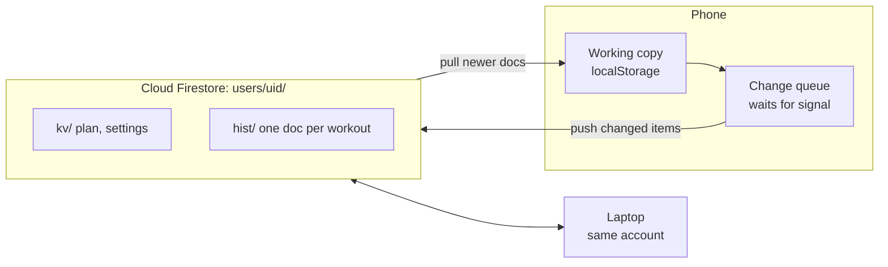

# Fitness App

A half list, half clock workout tracker for lifters who want the data. It started as a Google Keep checklist next to a stopwatch. Now it times every set and rest, and shows you what's actually moving your strength.

**[Open the app](https://majestic-jalebi-27b504.netlify.app)** · **[Take the tour](https://majestic-jalebi-27b504.netlify.app/preview.html?tour=1)** · **[Original Figma design](https://www.figma.com/design/7UXviOi1A98Iv7OmZk4VKL/Sean-s-App?node-id=0-1)**


## Why I built it

For years my gym setup was two apps side by side on an Android phone: a Google Keep checklist of the day's lifts on one half of the screen and the stock clock on the other. I ticked off each exercise, typed the weights and reps into the note, and used the stopwatch to keep my rest honest. No sign in, no flipping between pages. It just worked.


That note was the whole system. Sets, weights, reps, rest, time under tension, how long the session took and how many minutes were left for cardio, all typed by hand between sets.

Then I switched to iPhone and lost the split screen. And the note never gave anything back: no trends, no export, just text I'd scroll past. So I set out to rebuild what I'd been doing by hand, and make it keep the data.

Before writing any code I left myself this note:

> This simple half screen and half list is something you need to revisit it was quite rewarding going through this checklist yourself checking off each item not having to go through much flipping of pages or sign in: this is the simplicity you wanted to bring to an app timer and list but also when you switched to iOS how you lost that ability
> So you wanted to recreate it yourself and the clock was essentially there to help you manage your time. So I want a clock to still really be visible if you even exit the workout tab itself or give an option to pause the workout until you return but make it so that you really try to avoid leaving. That tab like no need to go to planning or analytics at this point. But do that without being annoying. This device really needs to feel like I can't do without it for the gym experience

That note became the rules for the app:

| From the note | In the app |
|---|---|
| Half list, half clock | Today is the checklist. Tap an exercise and the timer takes the bottom half of the screen. |
| Checking off each item | One button runs each set: start, done, rest, next. Each exercise ticks off on the list. |
| No flipping pages or sign in | Type your name and go. Cloud sync is there if you want it, never required. |
| The clock stays visible | Leave the workout and a live clock follows you on Today. Leaving asks whether to pause or end, and pause nudges you to push through. |
| Something you can't do without | Every set's weight, reps, time under tension and rest is recorded, charted, and yours to export as a backup file. |

It's built around how I train, but I think it could help other mature gym goers too: people who've lifted for years, know their numbers, and want something that keeps up without getting in the way.

| | |
|---|---|
| **Every set timed** | Time under tension and rest are recorded on their own, set by set. |
| **Fast logging** | Weight and reps prefill from last time, so you log them during rest. |
| **Analysis, not just logs** | Charts on what moves your strength, built from your own sets. |

New here? The app offers a one minute walk through of a sample year the first time you open it, or **[start it here](https://majestic-jalebi-27b504.netlify.app/preview.html?tour=1)**.

## What it does

| Train | Plan | Analyze |
|:---:|:---:|:---:|
|  |  |  |
| Today's workout is a checklist. One button runs each set: start, finish, rest, repeat. You get a warm up before the first set and 10 seconds to get set before lifting time starts. Before each exercise a small chart shows that set over your last six sessions, with today's target as the next point and a dotted line at last time's weight. Pause stops every clock, and leaving mid-workout asks to pause or end. Cardio after every workout is one switch in Settings: pick a machine and 10, 15 or 20 minutes. Machine taken? The ⋯ on any exercise swaps it with one from later in the week, and the two trade days for that week only. Time under tension and rest are recorded for every set. | Your whole week as color tiles on one screen, with today outlined and a tile for how the week is going. Workouts you missed or cut short show there as left over. Do one today, plan it for another day, or combine up to three into one make-up day. Tap a day to open its workout, and build workouts from a searchable exercise library. | Overview has one pie you can switch between plan kept, where your gym time goes, sets by muscle, work to rest, and cardio by machine. A cardio chart shows your minutes each week. Medals only count showing up, and each is dated from your history. Advanced looks at what changes your strength. Tap any point to see the sets behind it. |

Also: installs to the home screen, works with no signal, optional cloud sync across devices, and a back gesture that works from every screen.

## From Figma to app

I first designed this in Figma in early 2024: a week view, a workout screen with a big seven-segment timer, and color-coded states for working, logging, resting and moving between stations.


The first build stayed close to that design so I could test the core loop in a real gym.


Using it changed a lot:

| Figma | Now | Why |
|---|---|---|
| Five timer screens: workout, input, rest, transition, finished | Three: lifting, rest, next station | Logging happens during rest anyway, so a separate input timer was one more thing to tap. |
| Popups to confirm pausing and redoing a set | A single Undo | Dialogs mid-set slowed me down. |
| A list of days | Color tiles, the whole week on one screen | The list made it hard to see where you were in the week. A swipeable version fixed that but was awkward mid-session, so now every day is a tile and nothing scrolls. |
| A history tab | Analytics | A list of past workouts didn't tell me anything. Charts of what's changing did. |
| Target workout length and transition settings | A rest ratio | Rest is set length times a ratio, so harder sets get more rest on their own. |


Most screens also went through a round of side-by-side concepts. The schedule tried several layouts, went to swipeable color blocks, then became a grid of tiles after my first real workouts. Drag and drop in the plan editor felt fiddly on a phone, so it became tap a day, pick a workout. Analytics started with too many points and too much text, and ended with thin lines, colored points, and insights you only read when you tap. I tested paper, grey, charcoal and cream themes across every screen before going back to off-black.

## How the numbers work

Every number comes from logged sets. Charts stay locked until there's enough data and say how much more they need. The 1 Year Preview runs the same math on a generated year of training that follows a real Push, Pull, Legs, Upper, Lower plan.

| Metric | Method |
| --- | --- |
| Estimated max | Epley: `weight × (1 + reps / 30)` |
| Relative strength | A set's estimated max as a share of your best on that lift within 21 days either side, so long-term progress doesn't skew the comparison |
| Rate of gain | Slope through each month's best and the two months before it, in kg per month |
| Tension, set length, rest | Spearman rank correlation, with sets grouped into bins for the charts |
| Medals | Workouts, weeks in a row with 3 or more, personal records, weight moved and time under tension, each tier dated from your history |

## Cloud sync with Firestore

I wanted to log on my phone at the gym and check charts on my laptop without paying for a backend. Firebase's free Spark plan covers it, and it can't bill you: past the free quota it stops instead of charging.



- **Offline first.** Gyms have bad signal, so the phone keeps the working copy and nothing waits on the network. Changes queue and push when there's a connection.
- **Workouts can't be overwritten.** Plan and settings are one document per item, where the newest write wins. Each workout is its own document, merged by id, so two devices never overwrite each other's sessions.
- **Cheap by design.** Only items whose content changed are uploaded, tracked with a hash per item. Pulls only ask for documents newer than the last sync.
- **Works on a new phone.** Sign in or create an account right from the welcome screen, and your plan and history come down before the app opens.
- **Private.** Email sign-in through Firebase Auth, and rules that only let you read and write your own path:
  ```
  match /users/{uid}/{doc=**} {
    allow read, write: if request.auth != null && request.auth.uid == uid;
  }
  ```
- **Small.** Firestore Lite over REST, about 70 KB gzipped, loaded only after you sign in.

## Tech

- Vanilla JavaScript, HTML and CSS. No framework. The whole app builds into one self-contained HTML file of about 190 KB.
- Firebase Authentication and Cloud Firestore (Lite) for optional sync. Netlify for hosting. $0 a month to run.
- A service worker and web app manifest, so it installs and works offline.
- One rule decides what "back" means on every screen, wired to the phone's back gesture, so you can't get stuck.
- The preview runs in its own storage space, so it can never touch a real user's data on the same site.
- Playwright tests (13 files): the workout loop, back navigation, scheduling edge cases like editing a week after you've trained, cardio, analytics numbers checked against the raw history, the new user tour, and two devices syncing through a stand-in for Firebase, including a workout logged offline.

**How I built it:** I designed it in Figma first, then used Claude as a coding partner. I set the direction, tested in the gym and made the calls on what stayed and what went. Claude wrote most of the code.

## Run it locally

Needs Python 3 and nothing else.

```bash
python3 build.py              # writes dist/
python3 -m http.server -d dist 8000
```

Then open http://localhost:8000.

Tests:

```bash
pip install playwright && playwright install chromium
python3 tests/smoke.py
python3 tests/accounts.py
python3 tests/navigation.py
python3 tests/plan_days.py
python3 tests/plan_week_edit.py
python3 tests/workout_screen.py
python3 tests/leftover.py
python3 tests/overview_pie.py
python3 tests/swap_sync.py
python3 tests/cardio_lock.py
python3 tests/unit.py
python3 tests/tour.py
python3 tests/sync.py
```

### Setting up your own cloud sync

1. Create a project at console.firebase.google.com on the free Spark plan.
2. Authentication: turn on Email/Password and add your site's domain under Authorized domains.
3. Firestore: create a database (Standard edition, single region) and publish the rules above.
4. Add a web app and copy its config into `firebase.config.json` (see `firebase.config.example.json`). The config isn't a secret; the rules keep each person's data private.
5. Rebuild. A Cloud sync row appears in Settings.

`netlify.toml` is included, so connecting the repo to Netlify builds and deploys on every push.

## Project layout

```
src/
  src.html        template, styles, session engine, Today tab
  plan.js         plan and workout editor
  library.js      exercise library
  sched.js        Schedule tab, plan editor, exercise picker
  analytics2.js   analytics: overview, medals, drill-downs, custom charts
  nav.js          going back from anywhere
  cloud.js        cloud sync and its sign-in sheet
  sheets.js       settings, backup and restore
  seed_year.js    sample year for the preview
  tour.js         walk through of the preview for new users
tools/            cream theme variant, Firebase SDK bundler, single-file preview build
public/           manifest, service worker, icons, Firebase SDK
docs/screenshots  images for this README
tests/            Playwright tests
build.py          builds everything into dist/
```

## Credits

Timer digits use [DSEG](https://github.com/keshikan/DSEG) by keshikan, under the SIL Open Font License 1.1.

MIT licensed. Built by Sean Tyndale.
