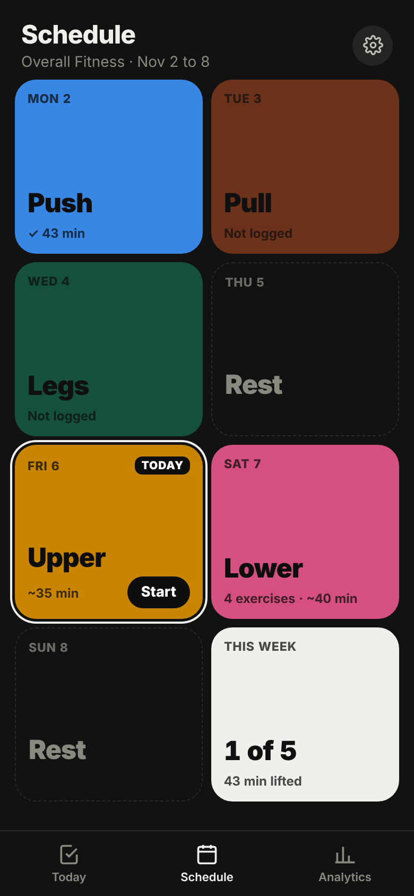
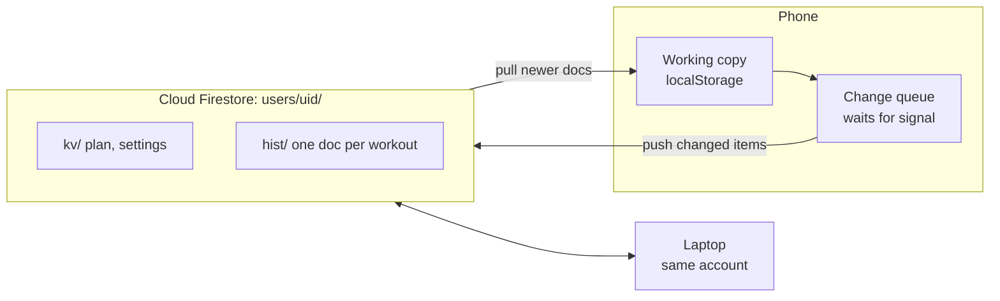

# Fitness App

A workout tracker for lifters who want the data. It times every set and rest, and shows you what's actually moving your strength.

**[Open the app](https://majestic-jalebi-27b504.netlify.app)** · **[See a year of data](https://majestic-jalebi-27b504.netlify.app/preview)** · **[Original Figma design](https://www.figma.com/design/7UXviOi1A98Iv7OmZk4VKL/Sean-s-App?node-id=0-1)**


## Why I built it

I'm the kind of lifter who wants to know why a lift went up or stalled. Most gym apps log weight and reps and stop there. I wanted the rest of the picture: how long each set lasted, how long I rested, and what that did to my strength.

So I built a tracker that records all of that while I train, and charts that show what's working.

| | |
|---|---|
| **Every set timed** | Time under tension and rest are recorded on their own, set by set. |
| **Fast logging** | Weight and reps prefill from last time, so you log them during rest. |
| **Analysis, not just logs** | Charts on what moves your strength, built from your own sets. |

## What it does

| Train | Plan | Analyze |
|:---:|:---:|:---:|
|  |  |  |
| Today's workout is a checklist. One button runs each set: start, finish, rest, repeat. Time under tension and rest are recorded for every set. | Your week as swipeable color blocks with today in the middle. Tap a day to pick its workout, and build workouts from a searchable exercise library. | Overview shows this week against your plan, which lifts are moving, and medals dated from your history. Advanced looks at what changes your strength. Tap any point to see the sets behind it. |

Also: installs to the home screen, works with no signal, optional cloud sync across devices, and a back gesture that works from every screen.

## From Figma to app

I first designed this in Figma in early 2024: a week view, a workout screen with a big seven-segment timer, and color-coded states for working, logging, resting and moving between stations.


The first build stayed close to that design so I could test the core loop in a real gym.


Using it changed a lot:

| Figma | Now | Why |
|---|---|---|
| Five timer screens: workout, input, rest, transition, finished | Three: lifting, rest, next station | Logging happens during rest anyway, so a separate input timer was one more thing to tap. |
| Popups to confirm pausing and redoing a set | A single Undo | Dialogs mid-set slowed me down. |
| A list of days | A swipeable week with today centered | The list made it hard to see where you were in the week. |
| A history tab | Analytics | A list of past workouts didn't tell me anything. Charts of what's changing did. |
| Target workout length and transition settings | A rest ratio | Rest is set length times a ratio, so harder sets get more rest on their own. |


Most screens also went through a round of side-by-side concepts. The schedule tried several layouts before landing on color blocks with today in the middle. Drag and drop in the plan editor felt fiddly on a phone, so it became tap a day, pick a workout. Analytics started with too many points and too much text, and ended with thin lines, colored points, and insights you only read when you tap. I tested paper, grey, charcoal and cream themes across every screen before going back to off-black.

## How the numbers work

Every number comes from logged sets. Charts stay locked until there's enough data and say how much more they need. The 1 Year Preview runs the same math on a generated year of training that follows a real Push, Pull, Legs, Upper, Lower plan.

| Metric | Method |
| --- | --- |
| Estimated max | Epley: `weight × (1 + reps / 30)` |
| Relative strength | A set's estimated max as a share of your best on that lift within 21 days either side, so long-term progress doesn't skew the comparison |
| Rate of gain | Slope through each month's best and the two months before it, in kg per month |
| Tension, set length, rest | Spearman rank correlation, with sets grouped into bins for the charts |
| Medals | Workouts, weeks in a row with 3 or more, personal records, weight moved and time under tension, each tier dated from your history |

## Cloud sync with Firestore

I wanted to log on my phone at the gym and check charts on my laptop without paying for a backend. Firebase's free Spark plan covers it, and it can't bill you: past the free quota it stops instead of charging.



- **Offline first.** Gyms have bad signal, so the phone keeps the working copy and nothing waits on the network. Changes queue and push when there's a connection.
- **Workouts can't be overwritten.** Plan and settings are one document per item, where the newest write wins. Each workout is its own document, merged by id, so two devices never overwrite each other's sessions.
- **Cheap by design.** Only items whose content changed are uploaded, tracked with a hash per item. Pulls only ask for documents newer than the last sync.
- **Private.** Email sign-in through Firebase Auth, and rules that only let you read and write your own path:
  ```
  match /users/{uid}/{doc=**} {
    allow read, write: if request.auth != null && request.auth.uid == uid;
  }
  ```
- **Small.** Firestore Lite over REST, about 70 KB gzipped, loaded only after you sign in.

## Tech

- Vanilla JavaScript, HTML and CSS. No framework. The whole app builds into one self-contained HTML file of about 190 KB.
- Firebase Authentication and Cloud Firestore (Lite) for optional sync. Netlify for hosting. $0 a month to run.
- A service worker and web app manifest, so it installs and works offline.
- One rule decides what "back" means on every screen, wired to the phone's back gesture, so you can't get stuck.
- The preview runs in its own storage space, so it can never touch a real user's data on the same site.
- Playwright tests for the workout loop, back navigation (29 checks), and two devices syncing through a stand-in for Firebase (17 checks), including a workout logged offline.

**How I built it:** I designed it in Figma first, then used Claude as a coding partner. I set the direction, tested in the gym and made the calls on what stayed and what went. Claude wrote most of the code.

## Run it locally

Needs Python 3 and nothing else.

```bash
python3 build.py              # writes dist/
python3 -m http.server -d dist 8000
```

Then open http://localhost:8000.

Tests:

```bash
pip install playwright && playwright install chromium
python3 tests/smoke.py
python3 tests/navigation.py
python3 tests/sync.py
```

### Setting up your own cloud sync

1. Create a project at console.firebase.google.com on the free Spark plan.
2. Authentication: turn on Email/Password and add your site's domain under Authorized domains.
3. Firestore: create a database (Standard edition, single region) and publish the rules above.
4. Add a web app and copy its config into `firebase.config.json` (see `firebase.config.example.json`). The config isn't a secret; the rules keep each person's data private.
5. Rebuild. A Cloud sync row appears in Settings.

`netlify.toml` is included, so connecting the repo to Netlify builds and deploys on every push.

## Project layout

```
src/
  src.html        template, styles, session engine, Today tab
  plan.js         plan and workout editor
  library.js      exercise library
  sched.js        Schedule tab, plan editor, exercise picker
  analytics2.js   analytics: overview, medals, drill-downs, custom charts
  nav.js          going back from anywhere
  cloud.js        cloud sync and its sign-in sheet
  sheets.js       settings, backup and restore
  seed_year.js    sample year for the preview
tools/            cream theme variant, Firebase SDK bundler
public/           manifest, service worker, icons, Firebase SDK
docs/screenshots  images for this README
tests/            Playwright tests
build.py          builds everything into dist/
```

## Credits

Timer digits use [DSEG](https://github.com/keshikan/DSEG) by keshikan, under the SIL Open Font License 1.1.

MIT licensed. Built by Sean Tyndale.
