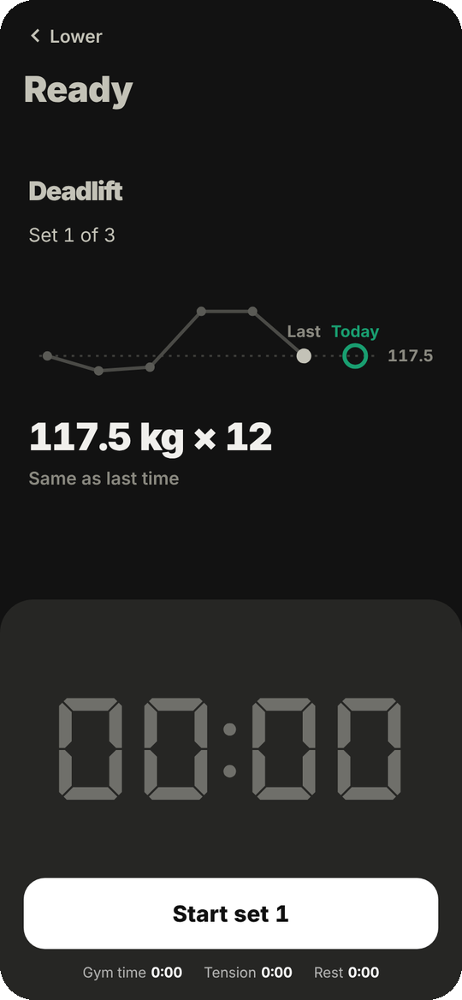
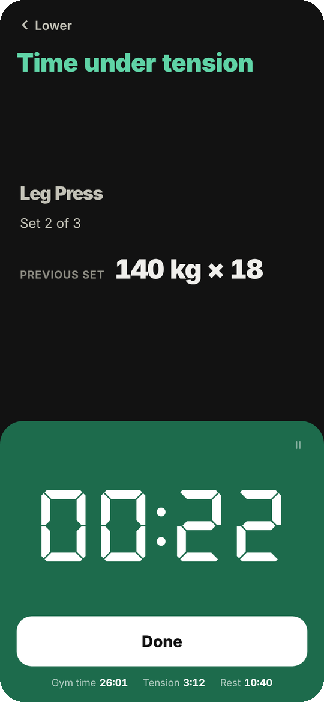
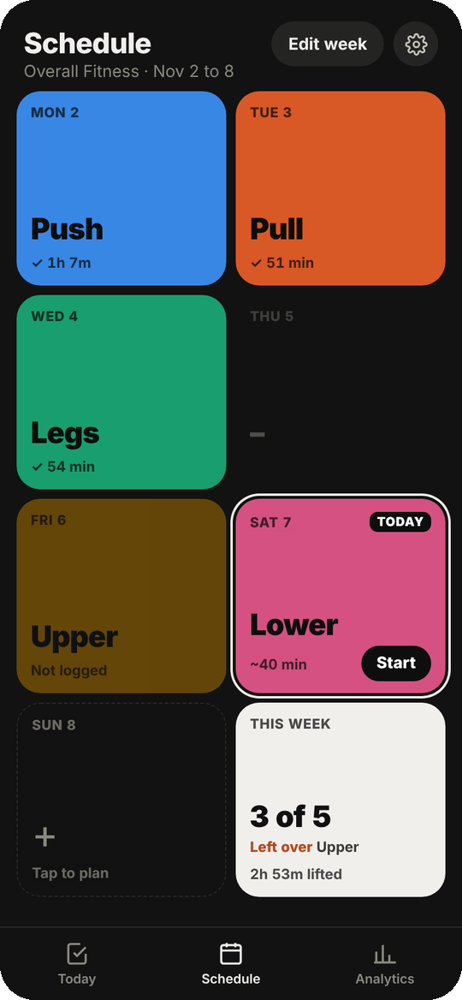
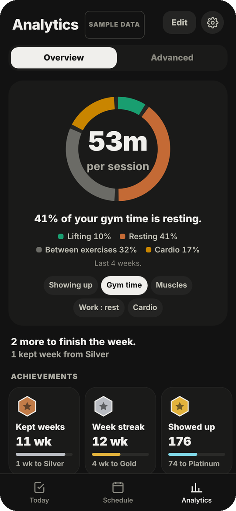
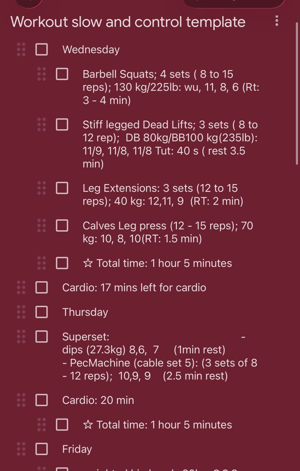
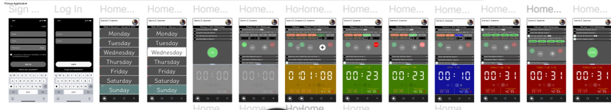
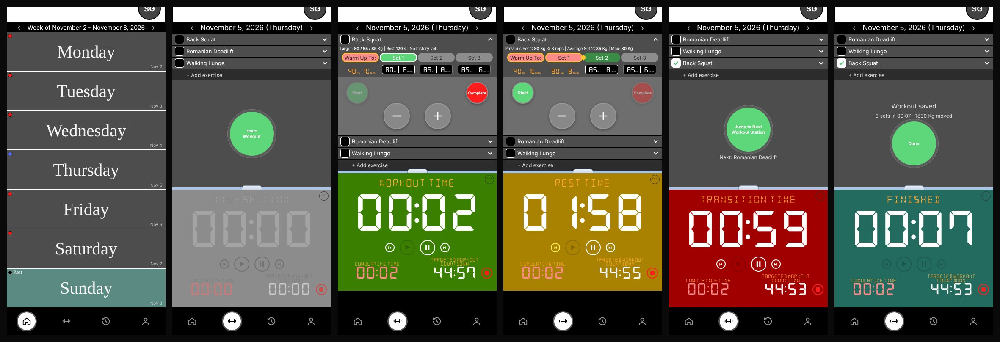
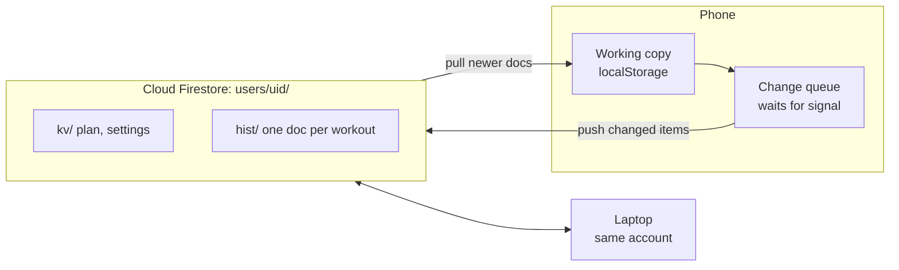

<div align="center">


# Fitness App

**My personal workout tracker. Half checklist, half clock, every set timed.**

[](https://majestic-jalebi-27b504.netlify.app)
[](https://majestic-jalebi-27b504.netlify.app/preview.html?tour=1)


**[Open the app](https://majestic-jalebi-27b504.netlify.app)** &nbsp;·&nbsp; **[Take the tour](https://majestic-jalebi-27b504.netlify.app/preview.html?tour=1)** &nbsp;·&nbsp; **[Send feedback](https://github.com/seansqlifting29/fitness-app/issues/new)**

<br>

&nbsp;
&nbsp;
&nbsp;


</div>

<br>

## Why I built it



For years I trained with Google Keep and the clock app side by side on an Android phone. A checklist of the day's lifts on one half, a stopwatch on the other. I ticked off each exercise and typed weights, reps and rest into the note as I went.

It was simple and it worked, until I moved to iPhone and lost the split screen. The notes also never gave anything back. No trends, no export, just text.

So I rebuilt that setup as an app, kept it just as simple, and made it hold on to the data.

**What it had to do**

- **List and clock on one screen.** The day's exercises, and a timer that takes half the screen when you start one.
- **Tick things off.** One button runs each set: start, done, rest, next.
- **No sign in to start.** Type your name and lift. Sync is optional.
- **Keep you on the workout.** The clock stays with you if you leave the workout, and pausing asks you to push through first. No nagging.
- **Give the data back.** Every set's weight, reps, time under tension and rest, charted and exportable.

<br clear="right">

## What it does

| Train | Plan | Analyze |
|---|---|---|
| A checklist and a seven segment clock | Your week as color tiles on one screen | One pie: plan kept, gym time, muscles, work to rest, cardio |
| Before each set, that set over your last six sessions and today's target | Missed or cut short workouts show up as left over to make up | Charts built from your own sets, tap any point to see them |
| Get set countdown with beeps, timed sets and rest | Swap a workout day, or an exercise when the machine's taken | Cardio minutes by week and by machine |
| Cardio after the lifts, one switch in Settings | Edit the week, even after you've trained | Medals that only count showing up |

Installs to the home screen, works with no signal, and syncs across devices if you sign in.

## Try it

This is built for me and the way I train, so it's opinionated. If you lift and want to give it a go, I'm always looking for feedback. **[Open an issue](https://github.com/seansqlifting29/fitness-app/issues/new)** with what worked, what didn't, or what you'd change.

New to it? The **[one minute tour](https://majestic-jalebi-27b504.netlify.app/preview.html?tour=1)** walks through a sample year of training.

## Under the hood

<details>
<summary><b>From Figma to app</b></summary>

I first designed this in Figma in early 2024: a week view, a workout screen with a big seven-segment timer, and color-coded states for working, logging, resting and moving between stations.



The first build stayed close to that design so I could test the core loop in a real gym.



Using it changed a lot:

| Figma | Now | Why |
|---|---|---|
| Five timer screens: workout, input, rest, transition, finished | Three: lifting, rest, next station | Logging happens during rest anyway, so a separate input timer was one more thing to tap. |
| Popups to confirm pausing and redoing a set | A single Undo | Dialogs mid-set slowed me down. |
| A list of days | Color tiles, the whole week on one screen | The list made it hard to see where you were in the week. A swipeable version fixed that but was awkward mid-session, so now every day is a tile and nothing scrolls. |
| A history tab | Analytics | A list of past workouts didn't tell me anything. Charts of what's changing did. |
| Target workout length and transition settings | A rest ratio | Rest is set length times a ratio, so harder sets get more rest on their own. |


Most screens also went through a round of side-by-side concepts. The schedule tried several layouts, went to swipeable color blocks, then became a grid of tiles after my first real workouts. Drag and drop in the plan editor felt fiddly on a phone, so it became tap a day, pick a workout. Analytics started with too many points and too much text, and ended with thin lines, colored points, and insights you only read when you tap. I tested paper, grey, charcoal and cream themes across every screen before going back to off-black.

</details>

<details>
<summary><b>How the numbers work</b></summary>

Every number comes from logged sets. Charts stay locked until there's enough data and say how much more they need. The 1 Year Preview runs the same math on a generated year of training that follows a real Push, Pull, Legs, Upper, Lower plan.

| Metric | Method |
| --- | --- |
| Estimated max | Epley: `weight × (1 + reps / 30)` |
| Relative strength | A set's estimated max as a share of your best on that lift within 21 days either side, so long-term progress doesn't skew the comparison |
| Rate of gain | Slope through each month's best and the two months before it, in kg per month |
| Tension, set length, rest | Spearman rank correlation, with sets grouped into bins for the charts |
| Medals | Workouts, weeks in a row with 3 or more, personal records, weight moved and time under tension, each tier dated from your history |

</details>

<details>
<summary><b>Cloud sync with Firestore</b></summary>

I wanted to log on my phone at the gym and check charts on my laptop without paying for a backend. Firebase's free Spark plan covers it, and it can't bill you: past the free quota it stops instead of charging.



- **Offline first.** Gyms have bad signal, so the phone keeps the working copy and nothing waits on the network. Changes queue and push when there's a connection.
- **Workouts can't be overwritten.** Plan and settings are one document per item, where the newest write wins. Each workout is its own document, merged by id, so two devices never overwrite each other's sessions.
- **Cheap by design.** Only items whose content changed are uploaded, tracked with a hash per item. Pulls only ask for documents newer than the last sync.
- **Works on a new phone.** Sign in or create an account right from the welcome screen, and your plan and history come down before the app opens.
- **Private.** Email sign-in through Firebase Auth, and rules that only let you read and write your own path:
  ```
  match /users/{uid}/{doc=**} {
    allow read, write: if request.auth != null && request.auth.uid == uid;
  }
  ```
- **Small.** Firestore Lite over REST, about 70 KB gzipped, loaded only after you sign in.

</details>

<details>
<summary><b>Tech</b></summary>

- Vanilla JavaScript, HTML and CSS. No framework. The whole app builds into one self-contained HTML file of about 270 KB.
- Firebase Authentication and Cloud Firestore (Lite) for optional sync. Netlify for hosting. $0 a month to run.
- A service worker and web app manifest, so it installs and works offline.
- One rule decides what "back" means on every screen, wired to the phone's back gesture, so you can't get stuck.
- The preview runs in its own storage space, so it can never touch a real user's data on the same site.
- Playwright tests (14 files): the workout loop, back navigation, scheduling edge cases like editing a week after you've trained, cardio, analytics numbers checked against the raw history, the new user tour, erasing and starting fresh, and two devices syncing through a stand-in for Firebase, including a workout logged offline.

**How I built it:** I designed it in Figma first, then used Claude as a coding partner. I set the direction, tested in the gym and made the calls on what stayed and what went. Claude wrote most of the code.

</details>

<details>
<summary><b>Run it locally and tests</b></summary>

Needs Python 3 and nothing else.

```bash
python3 build.py              # writes dist/
python3 -m http.server -d dist 8000
```

Then open http://localhost:8000.

Tests:

```bash
pip install playwright && playwright install chromium
python3 tests/smoke.py
python3 tests/accounts.py
python3 tests/navigation.py
python3 tests/plan_days.py
python3 tests/plan_week_edit.py
python3 tests/workout_screen.py
python3 tests/leftover.py
python3 tests/overview_pie.py
python3 tests/swap_sync.py
python3 tests/cardio_lock.py
python3 tests/unit.py
python3 tests/tour.py
python3 tests/fresh_start.py
python3 tests/sync.py
```

**Setting up your own cloud sync**

1. Create a project at console.firebase.google.com on the free Spark plan.
2. Authentication: turn on Email/Password and add your site's domain under Authorized domains.
3. Firestore: create a database (Standard edition, single region) and publish the rules above.
4. Add a web app and copy its config into `firebase.config.json` (see `firebase.config.example.json`). The config isn't a secret; the rules keep each person's data private.
5. Rebuild. A Cloud sync row appears in Settings.

`netlify.toml` is included, so connecting the repo to Netlify builds and deploys on every push.

</details>

<details>
<summary><b>Project layout</b></summary>

```
src/
  src.html        template, styles, session engine, Today tab
  plan.js         plan and workout editor
  library.js      exercise library
  sched.js        Schedule tab, plan editor, exercise picker
  analytics2.js   analytics: overview, medals, drill-downs, custom charts
  nav.js          going back from anywhere
  cloud.js        cloud sync and its sign-in sheet
  sheets.js       settings, backup and restore
  seed_year.js    sample year for the preview
  tour.js         walk through of the preview for new users
tools/            cream theme variant, Firebase SDK bundler, single-file preview build
public/           manifest, service worker, icons, Firebase SDK
docs/screenshots  images for this README
tests/            Playwright tests
build.py          builds everything into dist/
```

</details>

<br>

<div align="center">
<sub>Timer digits use <a href="https://github.com/keshikan/DSEG">DSEG</a> by keshikan (SIL Open Font License 1.1). MIT licensed. Built by Sean Tyndale.</sub>
</div>
